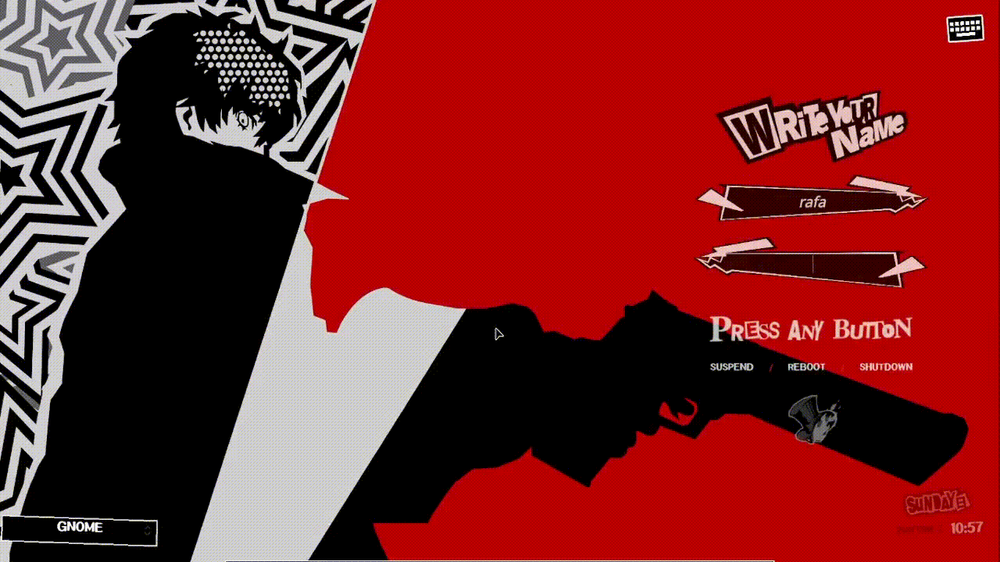

# Persona 5 SDDM Theme
### "Take Your Time"

A fully animated, kinetic login theme for SDDM (Simple Desktop Display Manager) inspired by the UI of **Persona 5**.



## 🎩 Features

* **Kinetic Login Animation:** A dagger flies in and pierces the "Press Any Button" prompt upon hitting Enter.
* **User Selector:** Pick the account to log into from a menu in the "Write Your Name" panel.
* **Session Selector:** Choose your desktop environment or window manager (GNOME, Hyprland, Plasma...) from the bottom-left corner. SDDM remembers your last choice.
* **Suspend Timer:** `SUSPEND` next to `REBOOT / SHUTDOWN` opens a menu to suspend now or after 5, 15, 30 minutes or 1 hour. A countdown shows on the button; click it again to cancel.
* **On-Screen Keyboard:** A built-in virtual keyboard (top-right icon) that types into the password field. No extra packages required.
* **Animated Logo:** The Phantom Thieves hat features a frame-by-frame fire animation loop.
* **Sprite-Based Clock:** The date and time are rendered using individual cut-out sprites, replicating the jagged calendar system from the game.
* **Reactive UI:** The interface shakes on an incorrect password and the field shows "WRONG!".
* **4K Ready:** Includes auto-scaling logic (`scaleFactor`) to look crisp on 1080p, 1440p, and 4K monitors.
* **Immersive Typography:** Uses **p5hatty** and **Arsenal** fonts (loaded locally) for an authentic look.

## 📦 Requirements

* **SDDM** (Simple Desktop Display Manager) with a **Qt5** greeter
* **Qt5 QML modules:** QtGraphicalEffects, QtQuick Controls 2, QtQuick Layouts

| Distro | Packages |
| --- | --- |
| Arch / Manjaro / EndeavourOS | `sudo pacman -S qt5-graphicaleffects qt5-quickcontrols2` |
| Debian / Ubuntu / Mint | `sudo apt install qml-module-qtgraphicaleffects qml-module-qtquick-controls2 qml-module-qtquick-layouts` |
| Fedora | `sudo dnf install qt5-qtgraphicaleffects qt5-qtquickcontrols2` |
| openSUSE | `sudo zypper install libqt5-qtgraphicaleffects libqt5-qtquickcontrols2` |

> **Qt6:** this theme is written for Qt5 (`QtGraphicalEffects` does not exist in Qt6).
> To check which Qt your greeter uses: `ldd $(which sddm-greeter) | grep -i qt`.
> If it shows `libQt6`, the theme needs to be ported before it can load.

## ⬇️ Installation

### Option 1: Automatic Script (Recommended)
The script copies the theme files, sets permissions and activates the theme. If you already have `/etc/sddm.conf.d/theme.conf.user`, it is backed up to `theme.conf.user.bak` first.

1.  **Clone the Repository:**
    ```bash
    git clone https://github.com/ricsrdocasro/sddm-persona5-theme.git
    cd sddm-persona5-theme
    ```

2.  **Run the Installer:**
    ```bash
    chmod +x install.sh
    sudo ./install.sh
    ```

3.  **Test It:**
    You can preview the theme without logging out:
    ```bash
    sddm-greeter --test-mode --theme /usr/share/sddm/themes/persona5
    ```

---

### Option 2: Manual Installation
If you prefer to move files yourself:

1.  **Copy the theme:**
    ```bash
    sudo mkdir -p /usr/share/sddm/themes/persona5
    sudo cp -r Assets Main.qml VirtualKeyboardPanel.qml OskKey.qml theme.conf metadata.desktop Preview.png /usr/share/sddm/themes/persona5/
    ```

2.  **Configure SDDM:**
    Edit your SDDM configuration file:
    ```bash
    sudo nano /etc/sddm.conf
    # OR: sudo nano /etc/sddm.conf.d/theme.conf.user
    ```

    Find the `[Theme]` section and set:
    ```ini
    [Theme]
    Current=persona5
    ```

## 🔧 Configuration

### Changing the Wallpaper
To use your own wallpaper, replace the background image inside the theme folder:

```bash
sudo cp /path/to/your/image.png /usr/share/sddm/themes/persona5/Assets/Images/background.png
```

### Suspend Times
The options in the suspend menu are defined at the top of `Main.qml`, in the `suspendOptions` list (label and seconds). Edit it to add or change times.

## 🩺 Troubleshooting

* **`module "QtGraphicalEffects" is not installed`** (or `QtQuick.Controls`): install the Qt5 packages from the Requirements table.
* **`Socket error: QLocalSocket::connectToServer: Invalid name`** when using `--test-mode`: harmless. The test greeter is not connected to the SDDM daemon. It does not appear on the real login screen.
* **The desktop selector always shows the first session:** SDDM only saves the last session after a *real* login. `--test-mode` never saves it. Log in once from the actual login screen.
* **Suspend does nothing in `--test-mode`:** also expected, since there is no daemon to receive the command. The menu and the countdown still work. Test the real suspend from the actual login screen.
* **Show only the theme's QML errors while testing:**
  ```bash
  sddm-greeter --test-mode --theme /usr/share/sddm/themes/persona5 2>&1 | grep -E "\.qml:[0-9]+"
  ```

## 📜 Credits & License

See `AUTHORS`, `CREDITS` and `COPYING` in this repository.